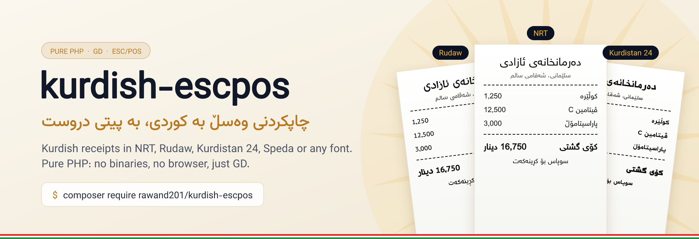
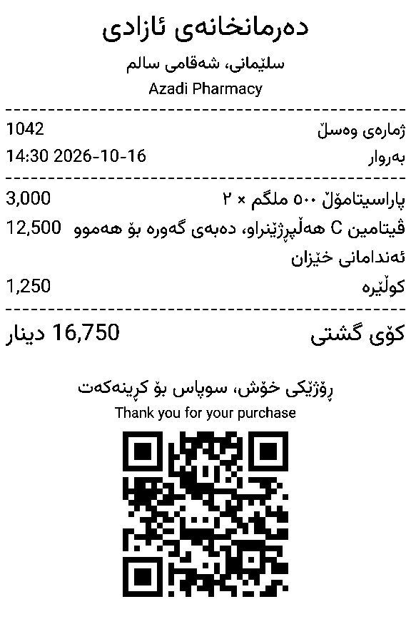
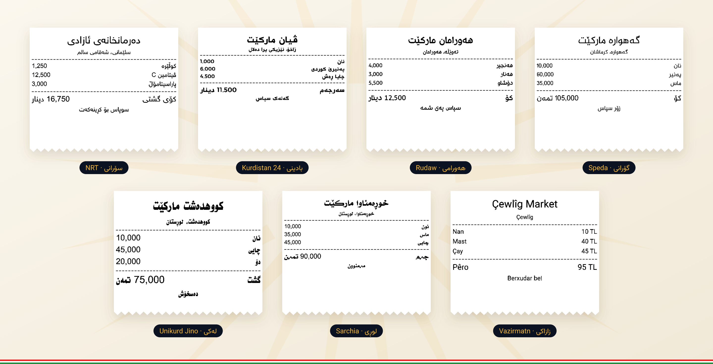

<p align="center">
  
</p>

<p align="center">
  <a href="https://packagist.org/packages/rawand201/kurdish-escpos"></a>
  <a href="https://github.com/RawanD201/kurdish-escpos/actions/workflows/tests.yml"></a>
  <a href="https://packagist.org/packages/rawand201/kurdish-escpos"></a>
  <a href="https://packagist.org/packages/rawand201/kurdish-escpos"></a>
  <a href="LICENSE"></a>
</p>

# kurdish-escpos

Print receipts in Kurdish, Arabic and English on thermal receipt printers,
with PHP. It works with Sorani, Badini, Hawrami and the other Kurdish
dialects. Every letter joins the right way, and every line reads in the
right direction.

You only need PHP and the GD extension. There is nothing else to install, so
it also works on normal shared hosting.

<div dir="rtl">

**kurdish-escpos** پاکێجێکی PHPیە بۆ چاپکردنی وەسڵ بە کوردی (سۆرانی، بادینی، هەورامی و شێوەزارەکانی تر)، عەرەبی و ئینگلیزی لەسەر پرینتەری وەسڵ. پیتەکان بە دروستی پێکەوە دەلکێن و دەق بە ڕێکی لە ڕاستەوە بۆ چەپ دەنووسرێت. هیچ بەرنامەیەکی دەرەکی پێویست نییە؛ تەنها PHP و GD.

</div>

```php
use Rawand\KurdishEscpos\Laravel\Facades\KurdishEscpos;

KurdishEscpos::print(
    KurdishEscpos::receipt()
        ->title('دەرمانخانەی ئازادی')
        ->text('سلێمانی، شەقامی سالم', align: 'center')
        ->divider()
        ->row('کوڵێرە', '1,250')
        ->row('ڤیتامین C', '12,500')
        ->divider()
        ->row('کۆی گشتی', '13,750 دینار', size: 32)
        ->qr('https://example.com/r/1042')
);
```

<p align="center">
  
</p>

## Contents

- [Why this package exists](#why-this-package-exists)
- [Features](#features)
- [Showcase](#showcase)
- [Installation](#installation)
- [Usage with Laravel](#usage-with-laravel)
- [Usage without Laravel](#usage-without-laravel)
- [Building receipts](#building-receipts)
- [Printers](#printers)
- [Fonts](#fonts)
- [Contributing](#contributing)
- [Credits](#credits)
- [License](#license)

## Why this package exists

Receipt printers do not know Kurdish:

- They do not have the Kurdish letters ڕ, ڵ, ێ and ە.
- They do not join letters together.
- They do not write from right to left.

So when you send Kurdish text to a receipt printer, it prints wrong or
broken text.

Drawing the receipt as a picture with PHP does not help either. PHP's image
functions draw every letter on its own, so the letters do not join. Some PHP
libraries fix this for Arabic, but Kurdish letters like ڵ and ێ still come
out broken.

This package solves the problem. It joins every letter the right way, puts
the words in the right order, draws the receipt as a picture, and sends the
picture to the printer. Every receipt printer can print a picture, so your
Kurdish text always looks right.

## Features

- Every Kurdish letter joins correctly, even ڵ and ێ.
- Works with Sorani, Badini, Hawrami and the other Kurdish dialects.
- Kurdish, Arabic and English can be on the same line, and numbers and
  prices stay in the right place.
- Use the included font, or your own font, such as NRT or Rudaw.
- Titles, text, item rows, lines, QR codes and empty space, for 80 mm and
  58 mm paper.
- See a picture of the receipt before you print it.
- Print to network printers, USB printers and Windows shared printers.
- Ready for Laravel, and works in any PHP project.
- Only needs PHP and GD.

## Showcase

The same receipt printed with six different fonts:

<p align="center">
  
</p>

## Installation

Requirements:

- PHP 8.2 or later
- The `gd` and `iconv` extensions, which are enabled on almost every PHP
  installation
- Laravel 11, 12 or 13, if you use the Laravel integration

Install the package with Composer:

```bash
composer require rawand201/kurdish-escpos
```

## Usage with Laravel

The service provider and the `KurdishEscpos` facade are registered
automatically. Configure your printer in `.env`:

```dotenv
KURDISH_ESCPOS_PRINTER_HOST=192.168.1.50   # network printer
# KURDISH_ESCPOS_PRINTER_PATH=/dev/usb/lp0 # or a printer exposed as a file
KURDISH_ESCPOS_WIDTH=576                   # 576 for 80 mm paper, 384 for 58 mm
```

To change other settings, publish the configuration file:

```bash
php artisan vendor:publish --tag=kurdish-escpos-config
```

Print a receipt:

```php
use Rawand\KurdishEscpos\Laravel\Facades\KurdishEscpos;

$receipt = KurdishEscpos::receipt()
    ->title('دەرمانخانەی ئازادی')
    ->row('پاراسیتامۆڵ', '3,000')
    ->row('کۆی گشتی', '3,000 دینار', size: 32);

KurdishEscpos::print($receipt);
```

To send a receipt to a printer other than the default one:

```php
use Rawand\KurdishEscpos\Printers\NetworkPrinter;

KurdishEscpos::print($receipt, new NetworkPrinter('192.168.1.60'));
```

Show a preview before printing, for example in a Blade view:

```php
$preview = KurdishEscpos::render($receipt)->pngDataUri();
```

```blade

```

### Printing from a queue

Rendering a receipt takes about 130 ms. To keep requests fast, print from a
queued job:

```php
use Illuminate\Contracts\Queue\ShouldQueue;
use Illuminate\Foundation\Queue\Queueable;
use Rawand\KurdishEscpos\Laravel\Facades\KurdishEscpos;

class PrintReceipt implements ShouldQueue
{
    use Queueable;

    public function __construct(public Order $order) {}

    public function handle(): void
    {
        $receipt = KurdishEscpos::receipt()->title($this->order->shop_name);

        foreach ($this->order->items as $item) {
            $receipt->row($item->name, number_format($item->total));
        }

        KurdishEscpos::print($receipt);
    }
}
```

## Usage without Laravel

```php
use Rawand\KurdishEscpos\Printers\NetworkPrinter;
use Rawand\KurdishEscpos\Receipt;
use Rawand\KurdishEscpos\Renderer;

$receipt = Receipt::make()
    ->title('سوپاس')
    ->text('ڕۆژێکی خۆش', align: 'center')
    ->feed();

$rendered = (new Renderer)->render($receipt);

file_put_contents('preview.png', $rendered->png);
(new NetworkPrinter('192.168.1.50'))->send($rendered->escpos);
```

## Building receipts

| Method | Description |
|---|---|
| `text($text, $size = null, $align = 'start')` | A paragraph. Long lines wrap, and `\n` starts a new paragraph. `start` is the right edge for Kurdish and Arabic and the left edge for English; `center` and `end` are also available. |
| `title($text, $size = 40)` | Large, centered text, such as the shop name. |
| `row($name, $price, $size = null)` | An item name and its price on one line. For Kurdish and Arabic the name is on the right and the price on the left; for Latin text it is the other way around. Long names wrap. |
| `divider()` | A dashed horizontal rule. |
| `qr($data, $size = null)` | A centered QR code, about 240 dots wide by default. |
| `feed($lines = 1)` | Vertical space. |

Sizes are measured in printer dots, at 203 dots per inch. The default text
size is 24. For 58 mm paper, create the receipt with
`Receipt::make(Receipt::WIDTH_58MM)`.

A receipt can also be given as an array or as JSON, which is convenient when
receipts are produced by another system:

```json
{
  "width": 576,
  "items": [
    { "type": "text", "text": "دەرمانخانەی ئازادی", "size": 40, "align": "center" },
    { "type": "row", "name": "کوڵێرە", "price": "1,250" },
    { "type": "divider" },
    { "type": "qr", "data": "https://example.com/r/1042" },
    { "type": "feed", "lines": 1 }
  ]
}
```

Unknown fields and invalid values are reported with a clear error message
rather than ignored.

## Printers

| Printer | Class | Example |
|---|---|---|
| Ethernet or Wi-Fi | `NetworkPrinter` | `new NetworkPrinter('192.168.1.50')` |
| USB on Linux | `FilePrinter` | `new FilePrinter('/dev/usb/lp0')` |
| Shared printer on Windows | `FilePrinter` | `new FilePrinter('\\\\localhost\\XPrinter')` |

Most network printers use port 9100. If yours uses another port, pass it as
the second argument.

`FilePrinter` only works when the printer is connected to the same computer
that runs PHP, and PHP must be allowed to write to it. On Linux, add the web
server user to the `lp` group.

The receipt is sent as a picture with the standard ESC/POS image command.
It works with Epson printers and with most printers that copy them, such as
Xprinter.

## Fonts

The package comes with the [Vazirmatn](https://github.com/rastikerdar/vazirmatn)
font. It has all Kurdish, Arabic and English letters, including the Kurmanji
letters ê, î, û, ç and ş.

### Using another font

You can use any Kurdish `.ttf` font, such as NRT or Rudaw:

```php
$renderer = new Renderer('/path/to/NRT-Reg.ttf');
```

In Laravel, set the path in `.env`:

```dotenv
KURDISH_ESCPOS_FONT=/var/www/fonts/NRT-Reg.ttf
```

If your font is missing some letters (many Kurdish fonts have no English
letters), those letters are drawn with Vazirmatn, so nothing is left blank.

### Checking a font

To check if a font works, run the command below. It tells you if any
Kurdish letters are missing, and it saves a sample receipt so you can see
how the font looks:

```bash
php artisan kurdish-escpos:check-font /path/to/font.ttf --preview=sample.png

# without Laravel
vendor/bin/kurdish-escpos-check-font /path/to/font.ttf sample.png
```

## Contributing

Contributions are welcome. Please read [CONTRIBUTING.md](CONTRIBUTING.md)
for the development setup and guidelines, and run the checks before opening
a pull request:

```bash
composer test
composer format
composer analyse
```

To report a security vulnerability, follow [SECURITY.md](SECURITY.md) instead
of opening a public issue. All changes are listed in
[CHANGELOG.md](CHANGELOG.md).

## Credits

- [RawanD201](https://github.com/RawanD201)

## License

The package is released under the [MIT License](LICENSE). The bundled
Vazirmatn font is licensed under the
[SIL Open Font License 1.1](resources/fonts/OFL-Vazirmatn.txt).
